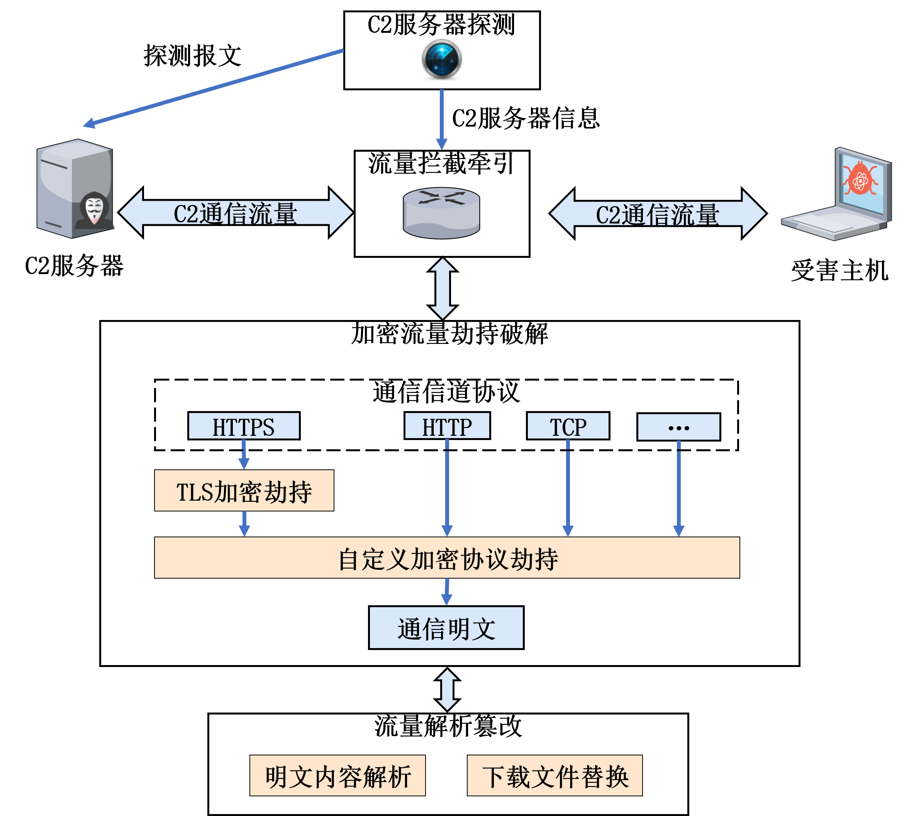
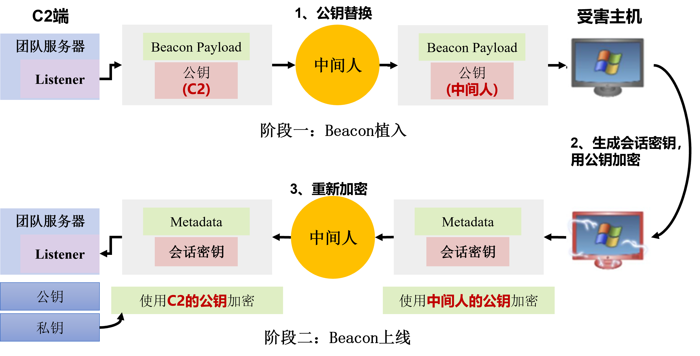
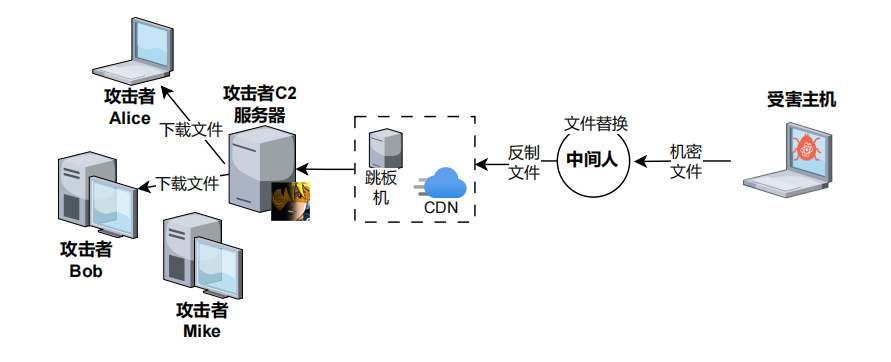
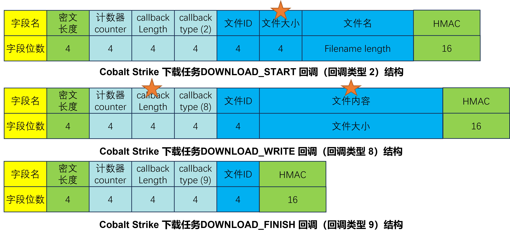
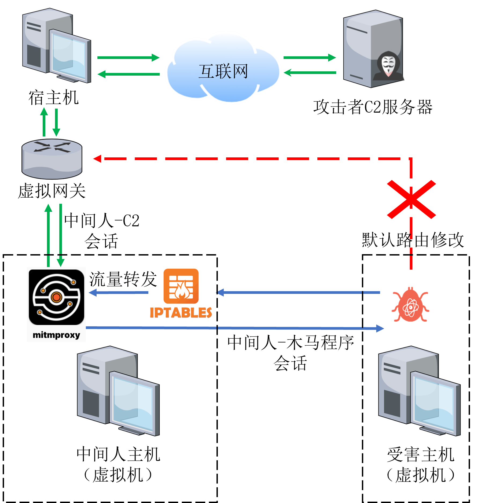
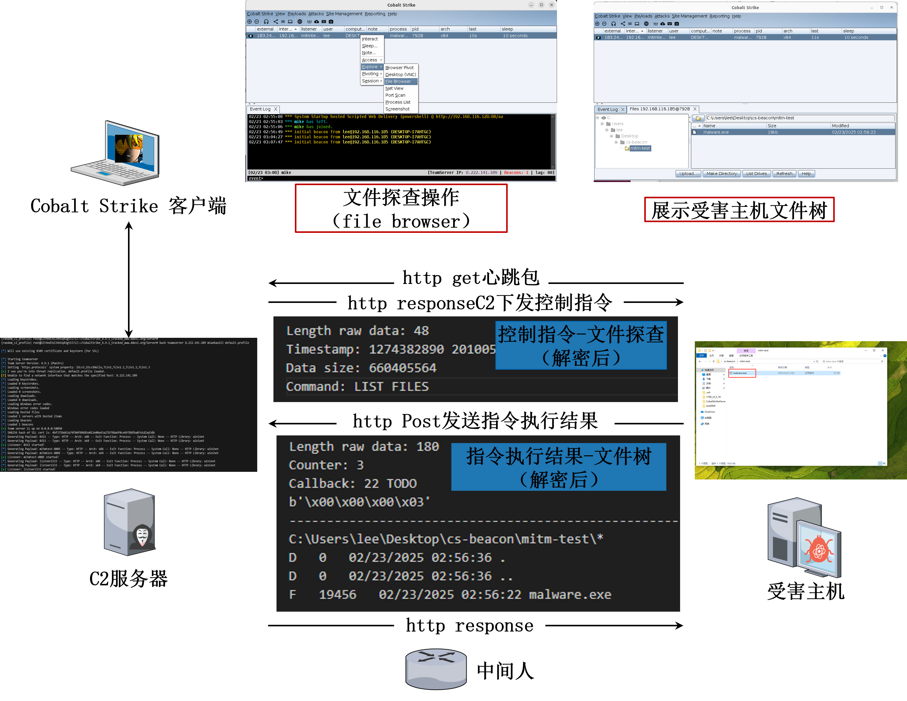
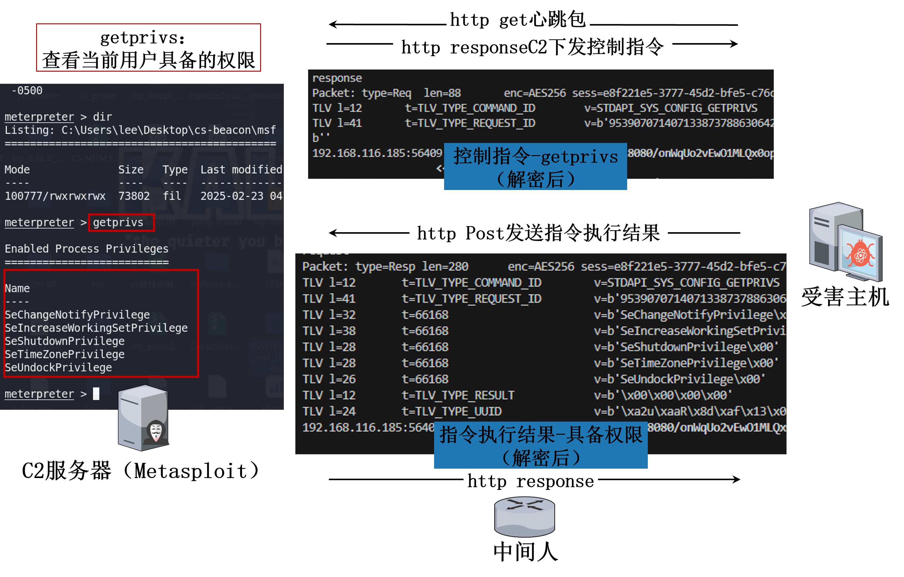
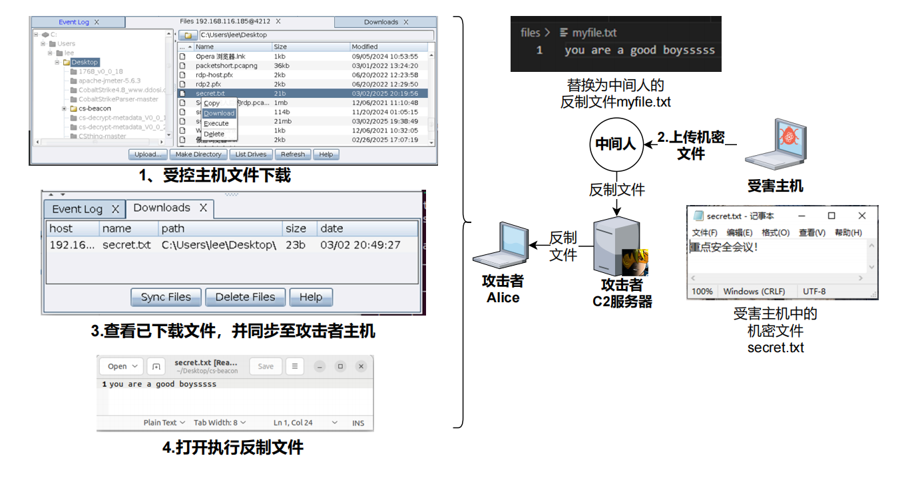

# MITM-Based Response to Encrypted C2 Communications

[English](README.md) | [简体中文](README_zh.md)

> **Overview:** A man-in-the-middle (MITM) framework for defending against command-and-control (C2) traffic. Built with mitmproxy add-ons, it supports real-time decryption, modification, and analysis of encrypted HTTP/HTTPS communications used by Cobalt Strike and Metasploit, as well as file replacement for active countermeasures and attacker tracing.

Encrypted C2 communications are widely used during the post-exploitation phase of cyberattacks. Cobalt Strike and Metasploit are among the most popular C2 tools; the original study reports that they account for 75% of C2 servers. Traditional response methods have limited effectiveness against encrypted traffic and complex network behavior. This project applies MITM techniques to network defense: by deploying a proxy at key points along the communication path, parsing traffic, and replacing public keys and TLS certificates, defenders can decrypt and modify malicious communications. Once plaintext is available, files being transferred to the attacker can be replaced to support countermeasures and tracing. The experiments described below demonstrate the approach across several tools and payload types. Compared with traffic blocking or honeypot redirection, it provides finer control over encrypted C2 communications for security operations and forensic analysis.

## Usage

The code consists of mitmproxy add-ons that use its Python API to parse, modify, and replace C2 HTTP traffic. Install the Python dependencies and configure the network to route the relevant traffic through the proxy.

- `cs-mitm/`: the Cobalt Strike add-on.
- `msf-mitm/`: the Metasploit / Meterpreter add-on.

Install the dependencies:

```bash
python3 -m pip install mitmproxy pycryptodome
```

For Cobalt Strike, run the script from its directory:

```bash
cd cs-mitm
python3 cs-mitm.py
```

For Metasploit / Meterpreter, load the add-on with mitmproxy from its directory:

```bash
cd msf-mitm
mitmdump --mode transparent --ssl-insecure -s msf-mitm.py
```

The Cobalt Strike script also imports `beaconParse`, which is not included in this repository. Supply that module in the Python import path before running the add-on. Network routing and transparent-proxy configuration must be prepared for the environment in use.

## Introduction

This project investigates a MITM-based response to encrypted C2 communications. It adapts a technique commonly used by attackers for defensive purposes. A MITM can intercept and alter data exchanged between two parties, potentially exposing sensitive information, changing data, or impersonating a participant. Such techniques must only be used with legal authorization.

By deploying a MITM proxy at key points in the communication path, defenders can inspect initial connection traffic, identify weaknesses in authentication, and replace TLS certificates and public keys. This makes it possible to decrypt and modify malicious C2 traffic and identify attacker behavior and control commands. When an attacker attempts to steal sensitive data, the defender can replace the transferred file with a customized countermeasure file to support attacker identification. The approach enables real-time monitoring and dynamic intervention in malicious remote-control sessions, reducing the risk of data leakage and system damage.

Compared with conventional C2 response techniques, the proposed approach supports both analysis and intervention. It applies to multiple remote-control tools, including Cobalt Strike and Meterpreter, and can operate as a network proxy without requiring interaction from the protected user. The original study describes the following contributions:

1. A systematic analysis of MITM-based responses to encrypted C2 communications, including weaknesses in the encryption and authentication mechanisms used by Cobalt Strike and Meterpreter over HTTP/HTTPS, and an active-defense model for encrypted C2 traffic in complex networks.
2. A proxy-based method for parsing traffic and replacing public keys and TLS certificates to intercept both application-level encryption and TLS. Experiments with Cobalt Strike and Meterpreter demonstrate real-time decryption and analysis without requiring user interaction, providing finer control than blocking or honeypot redirection.
3. A file-replacement countermeasure based on decrypted traffic. The experiments show that a replacement file can pass through intermediate network nodes and the C2 server to reach the attacker's host while retaining much of the original file's visible metadata.

## Encrypted C2 Communication Mechanisms

This section examines how Cobalt Strike and Meterpreter establish sessions and exchange data, focusing on their complete connection workflows and associated encryption and authentication mechanisms.

### Cobalt Strike Connection Workflow


Cobalt Strike supports staged and stageless payloads. In staged mode, a lightweight initial payload called a **Stager** establishes the first connection to the C2 server and downloads the full payload, called **Beacon**. Beacon provides capabilities such as command execution, file transfer, and remote control. The Stager acts as a bridge that retrieves Beacon, while Beacon performs the actual command-and-control operations. Staged deployment is used when a small initial payload is desirable for rapid delivery or avoiding security checks.

In stageless mode, the attacker delivers the complete payload directly to the target host. Once executed, it can establish a session without a separate payload download.

For staged payloads over HTTP, the workflow has three main phases: Beacon delivery, Beacon registration, and command and control.

#### (1) Beacon Delivery

Before Beacon is delivered, the attacker places a Stager on the target host through phishing, vulnerability exploitation, a watering-hole attack, or another intrusion method. When the host executes the Stager, it sends an HTTP GET request to the C2 server to download the full payload. The request may resemble a normal request for an image, CSS file, or other web resource to make it less conspicuous.

The C2 server responds with the complete Beacon payload.

Beacon contains a hard-coded 2048-bit RSA public key, which it uses in subsequent cryptographic operations. Beacon executes in memory to avoid leaving a payload file on disk.

#### (2) Beacon Registration

Registration is the process by which the delivered Beacon establishes communication with the C2 server. The server then displays the compromised host as available for command-and-control operations.

After the Stager decodes and executes Beacon in memory, Beacon sends its first heartbeat as an HTTP GET request. The request carries encrypted **Metadata**, which contains basic information about the host, such as system details, user information, and IP addresses, together with cryptographic key material. Metadata may be hidden in a Cookie header, the URI, or another request parameter.

The C2 server typically responds to the first heartbeat with an empty HTTP body, indicating that no task is pending.

The registration exchange establishes the key material for the encrypted session. Beacon generates random key material, includes it in Metadata, and encrypts Metadata with the RSA public key embedded during delivery. The heartbeat carries this encrypted data to the server. The server decrypts it with its private key and obtains the material needed to derive the symmetric session keys. The exact AES and HMAC key derivation is described in the Metadata parsing section below.

Once both sides have the same session keys, subsequent traffic, including tasks sent by the server and execution results returned by Beacon, is encrypted. A passive observer cannot decrypt that traffic without the relevant keys.

#### (3) Command and Control

After registration, Beacon periodically sends heartbeat requests to check for new tasks.

If a task is available, such as executing a command, transferring a file, or collecting information, the heartbeat response contains encrypted task data. Beacon decrypts the response with the negotiated AES key and executes the task on the host.

Beacon then packages the execution results and sends them to the C2 server in an HTTP POST request. The results are encrypted with the negotiated AES key. The server returns an empty response to acknowledge receipt.

Stageless payloads omit the separate Beacon delivery phase: the initial payload placed on the host already contains the full functionality.

In addition to these deployment modes and its application-level encryption, Cobalt Strike traffic has the following characteristics.

#### (1) Multiple Payload Types and Protocols

Beacon supports protocols such as HTTP, HTTPS, DNS, TCP, and SMB for registration and command and control. This project focuses on MITM interception of HTTP and HTTPS communications.

Cobalt Strike also offers multiple payload formats. Windows Stager Payload and Windows Stageless Payload target Windows hosts; Scripted Web Delivery provides script-based delivery; and the Stager/Stageless Payload generators can produce formats such as PowerShell, C, and Java for different delivery scenarios.

#### (2) TLS Traffic Encryption

When HTTPS is used, TLS connections are established before HTTP requests are sent. TLS adds a transport encryption layer to the tool's RSA- and AES-based application-level encryption and can provide server authentication when certificates are properly validated.

#### (3) Traffic Disguise and Obfuscation

Cobalt Strike supports customized C2 Profiles to make its traffic resemble legitimate services such as CDNs or social-media websites. A C2 Profile defines how Beacon communicates, including where C2 data is placed in HTTP headers, URIs, Cookies, or User-Agent fields. It can also apply encodings and add prefixes and suffixes to resemble normal web traffic, making detection and parsing more difficult.

### Meterpreter Connection Workflow

Meterpreter's overall connection workflow is similar to Cobalt Strike's. It supports staged and stageless payloads and follows the same broad phases: payload delivery, registration, and command and control.

During registration, its application-level cryptographic mechanism negotiates keys for subsequent traffic. It also uses heartbeats, task delivery, and result reporting, and supports communication channels such as HTTP, HTTPS, TCP, and DNS. Cobalt Strike's customizable C2 Profiles provide additional flexibility for disguising traffic compared with the Meterpreter configurations discussed here.

## Method Design

The proposed response method intercepts the application-level encryption and TLS layers used during malicious C2 session establishment. Once plaintext is available, it supports traffic analysis and file-replacement countermeasures. This section presents the architecture, the weaknesses in the relevant Cobalt Strike and Meterpreter encryption mechanisms, the interception methods, and the traffic modifications used for file replacement.

### Architecture



The framework aims to improve network defense by intercepting, analyzing, and modifying encrypted C2 communications.

An active-probing module first identifies C2 servers using JARM fingerprints and URL-matching probes. It records information such as server IP addresses and ports to locate and label the relevant endpoints. The original study describes this discovery mechanism in its threat-detection module. A traffic-interception and redirection module then routes communications with the identified C2 servers to the MITM platform for decryption, modification, analysis, and countermeasures.

For HTTPS and other TLS-protected traffic, the platform replaces or modifies certificates to access the encrypted content. It also handles application-level encryption: by analyzing packets and key-negotiation mechanisms, it substitutes public keys during negotiation and obtains session keys for real-time decryption.

The recovered plaintext can reveal control commands, data theft, and other attacker activities. By identifying file-transfer traffic, the platform can replace files being stolen with countermeasure files that are passed to the attacker's host, supporting tracing and reducing exposure of the original sensitive data.

### Intercepting Application-Level Key Negotiation

#### MITM Weaknesses in Cobalt Strike

Cobalt Strike's Windows Stager Payload, Scripted Web Delivery, and Stager Payload Generator use staged deployment.

During staged registration, Cobalt Strike combines RSA asymmetric encryption with AES symmetric encryption to protect communications. Public-key cryptography allows a public key to be distributed openly while the corresponding private key remains secret. A symmetric session key can then protect subsequent traffic over an otherwise insecure channel. The original discussion compares this authentication problem with unauthenticated Diffie-Hellman (DH) key exchange; the mechanism described here uses RSA-based key transport.

RSA (Rivest-Shamir-Adleman) is widely used for public-key encryption and digital signatures. Its security relies on the difficulty of factoring large integers. It uses a public key and a private key: knowing the public key does not ordinarily make it practical to recover the private key.

In the simplified RSA model, the public key is `PK = (e, n)` and the private key is `SK = (d, n)`, where `e` is the public exponent, `d` is the private exponent, and `n` is the modulus. For plaintext `m`, encryption with the recipient's public key is:

```text
c = m^e mod n    (1)
```

The recipient decrypts ciphertext `c` with its private key:

```text
m = c^d mod n    (2)
```

Encryption and decryption therefore use different keys. Publishing the public key does not by itself disclose the plaintext.

Previous work has decrypted Cobalt Strike traffic offline using known private keys. The original study cites NVISO research reporting that more than a quarter of publicly reachable Cobalt Strike servers shared the same key pair because cracked versions were widely used. Known private keys can be used to decrypt the application-level traffic associated with their public keys.

The proposed method can also cache known public/private key pairs and look for a match to recover session keys. However, it primarily considers the more general case in which the private key corresponding to Beacon's embedded public key is unknown.

Public-key exchange without authentication cannot establish that the received key belongs to the intended peer. This exposes the exchange to MITM substitution. A public key must be provisioned securely in advance or authenticated through another mechanism, such as a digital signature. A key delivered alongside the payload over an intercepted channel can otherwise be replaced.

The study validates public-key substitution against Cobalt Strike's application-level encryption. The workflow is illustrated below.



##### (1) Phase One: Beacon Delivery

During delivery, the C2 server returns Beacon, including its embedded RSA public key, to the Stager for in-memory execution. The MITM intercepts and decodes this download and replaces the embedded key with its own public key. A public-key prefix is used to locate the field to replace.

##### (2) Phase Two: Beacon Registration

When Beacon starts, it generates random material for the AES session keys and places that material in Metadata. It encrypts Metadata with the substituted public key and sends it in a heartbeat request.

The MITM locates Metadata in the request and decrypts it with the private key corresponding to the substituted public key. It can then derive the plaintext session keys. It re-encrypts Metadata with the C2 server's original public key and forwards it to the server. The server can decrypt the forwarded Metadata with its own private key, allowing registration to continue without an obvious interruption.

##### (3) Phase Three: Command and Control

After successful key negotiation, Beacon and the C2 server use the session keys for subsequent traffic. Because the MITM also knows those keys, it can decrypt and modify the exchanged data.

#### Cobalt Strike MITM Implementation


The following sections describe how packets are identified, parsed, decrypted, encrypted, and modified at each phase of Cobalt Strike communication.

**Algorithm 1. Cobalt Strike traffic interception**

```text
Input: HTTP packets
Output: Modified HTTP packets
while reading HTTP packets:
    if flow.request:  # Requests from Beacon
        if flow.request.method == GET:
            if Cookie in flow.request.headers:  # Beacon heartbeat
                metadata = RSADecrypt(Cookie, sk_mitm)
                dict[ip_tuple].rawKey = metadata[8:8 + 16]
                Cookie = RSAEncrypt(metadata, dict[ip_tuple].pk_cobalt_strike)
        if flow.request.method == POST:
            if flow.request.content != b'':  # Beacon task results
                content = AESDecrypt(content, dict[ip_tuple].rawKey)
                if parsed content contains a file transfer:
                    replace it with the countermeasure file
    if flow.response:  # Responses from the C2 server
        if flow.request.method == GET:
            if 'Cookie' not in flow.request.headers and the request path matches a Cobalt Strike download URL:
                replace Beacon's public key and record the original C2 public key in dict
            else:  # C2 heartbeat response
                plaintext = AESDecrypt(content, dict[ip_tuple].rawKey)
                parse plaintext and record the C2 task
        if flow.request.method == POST:  # Response acknowledging task results
            pass
```

The implementation intercepts the following packet types:

- HTTP responses delivering Beacon in phase one.
- Heartbeat HTTP GET requests and responses during registration and command and control.
- HTTP POST requests carrying Beacon's task execution results.

##### (1) Phase-One HTTP Responses Delivering Beacon

The MITM identifies a Beacon download response by checking that the corresponding request is a GET request and that its URL matches Cobalt Strike's generated URL rules. The `checksum8` algorithm checks whether the URL checksum is 92 or 93: 92 identifies an x86 Beacon download, while 93 identifies an x64 download.

It then locates and replaces the public key inside the received Beacon payload, as outlined in Algorithm 2.

**Algorithm 2. Public-key replacement in a downloaded Cobalt Strike Beacon**

```text
Input: Beacon download HTTP response content
Output: Beacon download response with a substituted public key
if content starts with "$s=New-Object IO.MemoryStream":
    # Scripted Web Delivery
    beacon = Decode1(content)
    pkStart = beacon.find(b'30819f300d06')  # Locate the public key
    dict[ip_tuple].pubKey = beacon[pkStart:pkStart + 256]
    beacon[pkStart:pkStart + 256] = pk_mitm  # Substitute the public key
    contentModified = Encode1(beacon)
else:
    # Stager Payload
    beacon = Decode2(content)
    if beacon has a PE header:
        pkStart = beacon.find(b'30819f300d06')  # Locate the public key
        dict[ip_tuple].pubKey = beacon[pkStart:pkStart + 256]
        beacon[pkStart:pkStart + 256] = pk_mitm  # Substitute the public key
        contentModified = Encode2(beacon)
    else:
        stop processing
return contentModified
```

Beacon runs as a PE image in memory, but its download traffic may be encoded or obfuscated. The traffic must therefore be decoded before the embedded key can be located. Existing work on Beacon download streams and PE parsing provides a basis for this processing.

The encodings examined in the study do not require a secret encryption key. They include Base64, XOR, chained XOR, and redundant data added before or after the payload. Stager Payload and Scripted Web Delivery have different download characteristics, so the method selects the appropriate decoder. Scripted Web Delivery begins with `$s=New-Object IO.MemoryStream`, while Stager Payload uses chained XOR. The detailed decoding process is outside the scope of this description. Because Cobalt Strike supports flexible, customized profile encodings, some configurations may not be parsed successfully.

To reduce the delay associated with fully parsing Beacon to find the key, the method searches directly for a prefix of the RSA public key's DER encoding.

DER (Distinguished Encoding Rules) is a binary encoding format commonly used for X.509 certificates and public keys. It follows ASN.1 (Abstract Syntax Notation One), a standard for describing data structures.

A DER-encoded RSA public key includes an algorithm identifier and key data, including modulus `n` and public exponent `e`. The prefix described in the original study is `0x30819f300d06092a864886f70d0101010500`, which includes the RSA algorithm OID. The method searches for the shorter prefix `0x30819f300d06` and uses its position as `pkStart`.

It extracts the original public-key field from `pkStart` to `pkStart + 256`, records it as the C2 server's public key `pkcs`, and replaces it with the MITM public key `pkmitm`. Because Beacon can open a new TCP connection for each request, the method stores the original server public key and session-key information under an IP tuple consisting of source IP, destination IP, and destination port.

##### (2) Heartbeat GET Requests and Responses During Registration and Command and Control

The relevant information carried by Beacon's heartbeat GET request is Metadata.

Metadata is central to communication between Beacon and the Cobalt Strike server. It includes a magic number (`0xBEEF`), a 16-byte random value, character-set identifiers, the Beacon ID and process ID, port information, architecture flags, version and build information, function pointers, the target IP address, computer name, user name, and Beacon process name.

The 16-byte random value is generated when Beacon starts and differs between executions. Its SHA-256 hash supplies two keys: the first 16 bytes become the AES key for symmetric encryption, and the last 16 bytes become the HMAC key for message authentication.

By default, the method obtains encrypted Metadata from the Cookie field. Other profiles may place it elsewhere or apply additional encodings. The MITM decrypts it with its RSA private key and extracts bytes 8 through 23, the 16-byte random value, from the plaintext. That value is recorded under the session's IP tuple. The plaintext Metadata is then encrypted with the original C2 public key captured during phase one, written back to the Cookie, and forwarded in the modified heartbeat.

A heartbeat response is identified by its associated GET request, a path that does not match the Beacon-download URL format, and an existing session record for the IP tuple. The method retrieves the corresponding key material, decrypts the response, and records the task sent by the C2 server.

##### (3) Phase-Three POST Requests Carrying Task Results

In the communication pattern examined here, task-result messages are identified by their POST method. The method retrieves the 16-byte random value associated with the IP tuple, derives the session keys, and decrypts the HTTP request body. It then parses the plaintext and can replace file-transfer contents when the returned task results contain a file being transferred. File replacement is described in a later section.

#### MITM Weaknesses in Meterpreter

Meterpreter supports communication channels such as HTTP and HTTPS. Over HTTP, it uses application-level key negotiation and encryption to avoid transmitting commands and results in plaintext. The following analysis uses Meterpreter / `reverse_http` as an example.

From the traffic perspective, staged deployment has the same three broad phases: Meterpreter delivery, registration, and command and control.

Unlike Cobalt Strike's embedded C2 public key, Meterpreter does not fix the server's public key inside the full payload. Instead, the C2 server transmits the public key after Meterpreter is running in memory and communicating with the server.

Before encrypted command-and-control traffic begins, the Metasploit server and Meterpreter negotiate a session key:

1. The Metasploit C2 server generates a 2048-bit RSA key pair. It places the public key in a TLV-encoded structure and sends it to Meterpreter with the `core_negotiate_tlv_encryption` command.
2. Meterpreter parses the packet and extracts the public key. It generates a random 256-bit AES key and encrypts that key with the received RSA public key.
3. Meterpreter sends the encrypted AES key back to the server. After negotiation, the RSA key pair is discarded and subsequent packets use the negotiated AES key.

Meterpreter traffic uses TLV (Type-Length-Value) encoding. The outer packet is XOR-encoded with a key carried in its first four bytes. The inner structure includes a session ID and an encryption flag indicating whether, and how, the packet is encrypted. If the flag is 0, the following data is plaintext TLV content. If it is 1, the packet includes a 16-byte AES initialization vector (IV) followed by AES-encrypted TLV content for AES-256 decryption.


Despite this encryption, the key exchange is susceptible to MITM substitution. Before Meterpreter receives the server's RSA public key, the MITM can replace it with its own key. Meterpreter then encrypts the AES session key with the substituted public key. The MITM decrypts that value with its private key, records the AES key, and re-encrypts it with the server's original public key. The server receives a valid encrypted session key and the session continues, while the MITM can decrypt subsequent traffic.

#### Meterpreter MITM Implementation

**Algorithm 3. Meterpreter traffic interception**

```text
Input: HTTP packets
Output: Modified HTTP packets
while reading HTTP packets:
    if flow.request:
        XOR-decode the Meterpreter packet
        if encryption_flag == 0:
            parse plaintext TLV data
            if TLV_Data_Type == 550:  # RSA public key
                dict[ip_tuple].pubKey = TLV_Data_Value
                TLV_Data_Value = pk_msf
                re-encode the modified plaintext
        if encryption_flag == 1:
            TLV_Data = AESDecrypt(TLV_Data_enc, dict[ip_tuple].aesKey)
            parse plaintext TLV_Data
    elif flow.response:
        XOR-decode the Meterpreter packet
        if encryption_flag == 0:
            if TLV_Data_Type == 553:  # Session key
                aesKey = RSADecrypt(TLV_Data_Value, sk_mitm)
                dict[ip_tuple].aesKey = aesKey
                TLV_Data_Value = RSAEncrypt(metadata, dict[ip_tuple].pk_msf)
        if encryption_flag == 1:
            TLV_Data = AESDecrypt(TLV_Data_enc, dict[ip_tuple].aesKey)
            parse plaintext TLV_Data
```

The pseudocode above retains the structure of the original README. The HTTP message directions used for public-key and session-key handling are described below.

The MITM intercepts HTTP traffic between the server and Meterpreter and processes the packet structure, including XOR decoding and TLV parsing.

RSA key negotiation takes place before AES encryption is enabled. The RSA public key is carried in a TLV field whose type identifier is 550. For a server HTTP response with an encryption flag of 0 and a matching TLV type, the method replaces the field value with the MITM's generated 2048-bit RSA public key.

When intercepting a Meterpreter client request with an encryption flag of 0, the TLV field identified by type 553 contains the encrypted, randomly generated 256-bit AES key. The MITM decrypts it with its private key and stores the recovered AES key under the tuple of target IP, C2 server IP, and C2 server port. This key can decrypt subsequent traffic between Meterpreter and the server.

The method re-encrypts the AES key with the Metasploit server's original public key so that the server can decrypt it and registration can complete.

Requests and responses with an encryption flag of 1 indicate encrypted command-and-control traffic. The method retrieves the negotiated AES key for the session, decrypts the contents, and makes the plaintext available for further analysis or modification.

### TLS Interception

This section analyzes the susceptibility of Cobalt Strike and Meterpreter HTTPS channels to MITM interception. Table 1 summarizes the certificate-validation behavior examined in the original study.

Meterpreter is considered first because its payload documentation describes TLS authentication in detail and its public source code allows the relevant implementation to be examined. It mainly uses WinInet or WinHTTP for HTTPS. These APIs have similar calling patterns and interfaces but differ in their underlying behavior. WinHTTP offers finer control over HTTP/HTTPS operations.

The WinHTTP implementation supports **Paranoid Mode**, including SHA-1 certificate-hash pinning. The `HandlerSSLCert` option can be used to configure the C2 server certificate when generating the payload so that Meterpreter communicates only with a server presenting the expected certificate. If the certificate hash does not match, the connection is terminated. This is TLS certificate pinning.

The study's certificate-substitution experiments found that, without the relevant certificate-pinning configuration, the tested WinInet and WinHTTP Meterpreter payloads did not validate ordinary TLS certificate properties, such as a trusted issuing CA, matching Common Name (CN), or revocation status. These default configurations therefore did not prevent MITM interception.

The source analysis identified the following certificate-validation flags:

- `SECURITY_FLAG_IGNORE_UNKNOWN_CA`: ignore an untrusted issuing CA and allow self-signed certificates.
- `SECURITY_FLAG_IGNORE_CERT_DATE_INVALID`: ignore certificate date errors.
- `SECURITY_FLAG_IGNORE_CERT_CN_INVALID`: ignore CN mismatches.
- `SECURITY_FLAG_IGNORE_CERT_WRONG_USAGE`: ignore incorrect certificate usage.

These settings explain why the tested default clients can accept self-signed, expired, or substituted certificates without strict trust validation.

**Table 1. TLS implementation weaknesses**

| Remote-control tool | Payload type | API | Validates certificate trust | Validates certificate hash |
| :---: | :--- | :---: | :---: | :---: |
| Meterpreter | reverse_https | WinInet | No | No |
| | reverse_winhttps | WinHTTP | No | No |
| | reverse_winhttps (StagerVerIfySSLCert configured) | WinHTTP | No | Yes |
| Cobalt Strike | All types | WinInet | No | No |
| | All types | WinHTTP | No | No |

For the Cobalt Strike versions examined in the original study, neither self-signed nor CA-issued C2 certificates were subject to effective certificate validation. A MITM could therefore present a substituted self-signed certificate to Beacon and establish a separate TLS connection to the server, decrypting traffic between the two connections.

In these configurations, TLS obscures traffic but does not provide effective server authentication because the generated client does not validate the server certificate. Cobalt Strike originally used WinInet for HTTP/HTTPS and added a WinHTTP implementation after version 4.9. The original study reports that SHA-1 certificate-hash validation was still unsupported in the reviewed version 4.10.1.

### File-Replacement Countermeasures

After intercepting both application-level encryption and TLS, the recovered plaintext can be decoded, analyzed, and modified in greater detail. The study explores file replacement as a countermeasure: when an attacker steals a sensitive or confidential file, the MITM substitutes a countermeasure program file before the transfer reaches the C2 server.

Cobalt Strike provides a graphical interface for downloading files from the C2 server to the operator's local host. If the operator opens or runs the replacement file, it can support tracing through intermediate network nodes and the C2 server. The study validates this mechanism for Cobalt Strike.



The MITM detects file transfers through rule matching in decrypted Cobalt Strike traffic. For the HTTP channel, after profile obfuscation is removed, the data uploaded by Beacon is AES-encrypted. The first four bytes indicate the ciphertext length, and the final 16 bytes contain an HMAC message-authentication code.

The decrypted data begins with a four-byte `counter`, used to identify message order or uniqueness. It is followed by a four-byte `callback length` and a four-byte `callback type`. The callback type determines how the remaining content is parsed. This method focuses on callbacks associated with file transfers.


Cobalt Strike supports uploads and downloads for file transfer. For a file being downloaded from the target host to the C2 server, the callback sequence is:

- `DOWNLOAD_START` (callback type 2): starts the transfer and creates the destination file. Its callback data includes the file ID, expected file size, and original file path on the target host.
- `DOWNLOAD_WRITE` (callback type 8): writes data to the file. Its callback fields include the file ID and file contents.
- `DOWNLOAD_COMPLETE` (callback type 9): marks the transfer for the file ID as complete.



The MITM modifies the file-size field in `DOWNLOAD_START`, together with the callback length and file contents in `DOWNLOAD_WRITE`.

## Experiments and Evaluation

### Experimental Setup

The approach was evaluated using a Kali-rolling 2023.3 virtual machine as the MITM host, a Windows 10 virtual machine as the target host, and an Ubuntu 20.04 cloud server as the C2 server.



The MITM and target hosts ran in VMware virtual machines, while the C2 server ran on Alibaba Cloud. To simulate interception, all traffic from the target host passed through the MITM host. The virtual machines used a NAT network, and the target's routing table was configured with the MITM IP address as its default gateway in place of the previous default route.

On the MITM host, iptables forwarding rules redirected traffic addressed to the C2 server's IP and port to the proxy. mitmproxy supplied transparent proxying, real-time HTTP/HTTPS interception, traffic analysis, and modification. Its TLS handling could substitute certificates and establish separate client-side and server-side TLS connections. Its Python add-on interface provided automated parsing and modification of the communication data.

This setup was used to validate and evaluate the proposed response method.

### Applicability of MITM Interception to Encrypted C2 Traffic

The table values below are reproduced from the original study. `Yes` and `No` correspond to its success and failure marks; blank cells indicate results that were not specified in the original tables.

#### Cobalt Strike Evaluation

The experiment used Cobalt Strike 4.9.1, which the original study dates to October 10, 2023. The tested build was a cracked distribution published by [ddosi.org](https://ddosi.org/) on November 6, 2023. Four payload types were tested over both HTTP and HTTPS: Windows Stager Payload, Scripted Web Delivery, Stager Payload Generator with PowerShell delivery, and Windows Stageless Payload.

**Table 2. Effectiveness of Cobalt Strike MITM interception**

| Protocol | Payload type | TLS interception | Application-level encryption interception |
| :---: | :--- | :---: | :---: |
| HTTP | Windows Stager Payload | | Yes |
| | Scripted Web Delivery | | Yes |
| | Stager Payload Generator (PowerShell) | | Yes |
| | Windows Stageless Payload | | No |
| HTTPS | Windows Stager Payload | Yes | Yes |
| | Scripted Web Delivery | No | |
| | Stager Payload Generator (PowerShell) | Yes | Yes |
| | Windows Stageless Payload | Yes | No |

The evaluation considered whether the method could intercept application-level encryption and whether it could intercept TLS.

Over HTTP, Windows Stager Payload, Scripted Web Delivery, and Stager Payload Generator all use staged deployment. The initial Stager downloads the complete control payload, giving the MITM an opportunity to locate and replace its public key. During registration, the MITM recovers session-key material and forwards Metadata encrypted with the original server key. All three staged variants in the experiment allowed application-level interception and recovery of plaintext traffic.

Windows Stageless Payload does not download the complete Beacon over the intercepted channel. The initially delivered payload already has full functionality, leaving no equivalent phase-one opportunity to replace the embedded key. The tested method therefore could not intercept Cobalt Strike's application-level encryption for that payload.



For HTTPS, the original discussion describes using mitmproxy's certificate-substitution and TLS-interception capabilities to recover HTTP plaintext from staged payload traffic that does not enforce certificate pinning. The tested Cobalt Strike 4.9.1 configuration used WinInet and did not support SHA-1 certificate-hash validation. Table 2 records the reported result for each payload, including unsuccessful TLS interception for the HTTPS Scripted Web Delivery case.

Once the applicable encryption layers were intercepted, the MITM could decrypt control commands and returned execution results. In the illustrated example, the operator browsed files through the Cobalt Strike client. The server delivered the file-listing command in a heartbeat response. Using the AES key recovered during registration, the MITM decoded the `LIST FILES` command in real time. Beacon returned the file tree in an HTTP POST request; the MITM decrypted that response data, and the Cobalt Strike client also displayed the file tree.

#### Meterpreter Evaluation

The Meterpreter experiment used Metasploit version 6.4.44, which the original study dates to January 8, 2025. Tested payloads included `reverse_http`, `reverse_https`, `reverse_winhttp`, `reverse_winhttps`, and `reverse_winhttps` with `HandlerSSLCert` configured. Table 3 also records the stageless `Meterpreter_reverse_http` case.

**Table 3. Effectiveness of Meterpreter MITM interception**

| Protocol | Payload type | TLS interception | Application-level encryption interception |
| :---: | :--- | :---: | :---: |
| HTTP | reverse_http | | Yes |
| | reverse_winhttp | | Yes |
| | Meterpreter_reverse_http | | Yes |
| HTTPS | reverse_https | Yes | Yes |
| | reverse_winhttps | Yes | Yes |
| | reverse_winhttps (HandlerSSLCert configured) | No | |

Over HTTP, the application-level encryption used by the staged `reverse_http` and `reverse_winhttp` payloads could be intercepted to recover plaintext. The stageless `Meterpreter_reverse_http` payload was also susceptible: although its full payload is delivered initially, it does not embed a fixed RSA public key. Its public key is transmitted during registration, allowing the same substitution technique. The experiment confirmed that this case was also interceptable.

Over HTTPS, Meterpreter's WinHTTP implementation supports certificate pinning. However, `reverse_https` and `reverse_winhttps` without the relevant `HandlerSSLCert` configuration remained susceptible to mitmproxy certificate substitution. When `reverse_winhttps` was generated with the expected certificate hash pinned through the configuration described in the study, TLS interception failed.



The illustrated example shows a Metasploit listener accepting a Meterpreter session, after which the operator issues `getprivs`. The MITM uses the previously recovered AES key to decrypt the HTTP heartbeat response and identify the `GETPRIVS` command. The target returns the user's privileges in an HTTP POST request. The MITM decrypts that result, including privileges such as `SeShutdownPrivilege`, and the C2 terminal also displays the privilege list.

These experiments demonstrate the applicability of the method across several Cobalt Strike and Meterpreter payload types over HTTP and HTTPS. When defenders detect a susceptible post-exploitation remote-control session, MITM interception can recover communications for behavior analysis and support further traffic modification and tracing.

### Visibility of File-Replacement Countermeasures

The file-replacement experiment simulated an operator using Cobalt Strike to browse files and download a file of interest after Beacon had been deployed. Beacon's traffic was already under MITM interception. The evaluation examined whether replacement changed the file information shown in the Cobalt Strike client, whether those changes could draw suspicion, and whether the replacement file reached and ran on the operator's host.

**Table 4. Visibility and functionality of file replacement**

| Evaluation criterion | Description | Satisfied |
| :--- | :--- | :---: |
| Filename preservation | Does the replacement retain the original filename? | Yes |
| File-path preservation | Does the stored path match the original path? | Yes |
| Extension preservation | Does the replacement retain the original extension? | Yes |
| File-size consistency | Does the replacement have the same size as the original? | No |
| Execution | Can the countermeasure file execute successfully? | Yes |

The Cobalt Strike client displays downloaded files with their names, paths, extensions, creation times, and sizes. The experiment found that the original name, path, and extension were preserved. The displayed size changed to the replacement file's size. Creation time was excluded from the evaluation because it reflected creation on the C2 server. Retaining the other fields made the replacement less conspicuous.

The operator then downloaded the transferred file from the C2 server to the local host and ran it. The replacement executed successfully. The original study discusses using different replacement files for different extensions to support countermeasures and tracing.

In the demonstration below, the operator downloads the confidential file `secret.txt`. The MITM detects the file-transfer task result in an HTTP POST request and substitutes the contents of the countermeasure file `myfile.txt`. The substituted file is stored on the C2 server and synchronized to the operator's host through the Cobalt Strike client. The experiment reports that the replacement reached the host and was executed. This validates the feasibility of file replacement after decryption and illustrates its limited visible changes.



## Summary

This project presents a MITM-based response to encrypted C2 communications used by Cobalt Strike and Meterpreter. By intercepting, decrypting, and modifying traffic, the approach addresses susceptible TLS and application-level encryption configurations.

The study analyzes both tools' communication mechanisms and identifies weaknesses in key authentication and certificate validation. Public-key substitution can expose session keys, allowing real-time decryption and analysis without interaction from the protected user. It also describes file replacement as a countermeasure that can pass through intermediate network nodes and the C2 server to reach the operator.

Experiments across multiple payload types and HTTP/HTTPS channels demonstrate the method's applicability, while also identifying configurations that prevent interception. The file-replacement experiment shows that transferred content can be changed while preserving the original filename, path, and extension; the displayed file size changes. These results support the use of fine-grained traffic analysis and intervention in authorized security-response research.
